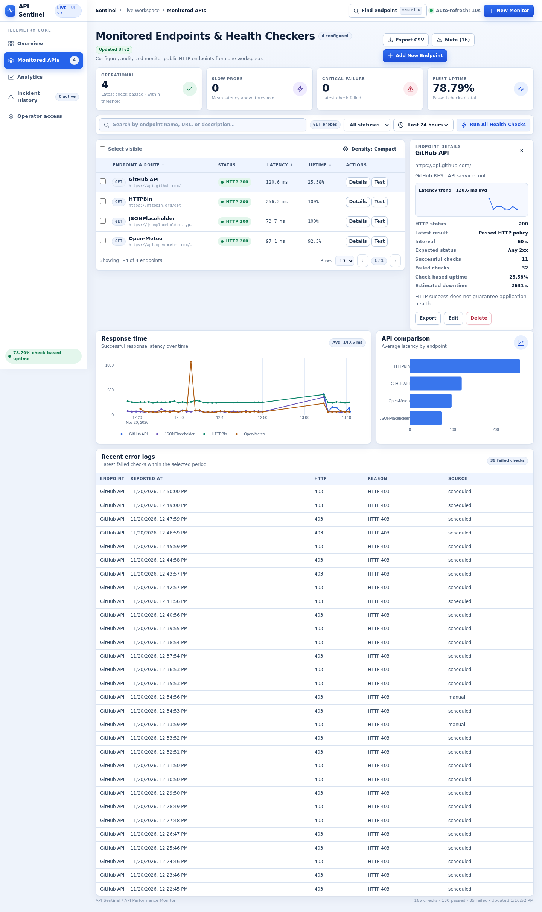

# API Sentinel · API Performance Monitor

API Sentinel sends real HTTP GET probes to public APIs and stores the results in SQLite. Its updated light **UI v2** dashboard is table-first and shows endpoint status, historical latency, cross-API comparisons, error logs and check-based uptime. Buttons include hover, press, focus, ripple and loading feedback. There are no generated monitoring results in the running app. The optional seed command registers URLs only.

## Quick start

Requirements: Python 3.11+ (verified on 3.11 on Windows 11 and 3.13 on Linux), Windows 11, Linux or macOS - all natively, no WSL - and direct Internet/DNS access for public probes.

```bash
cd API_Performance_Monitor
python -m venv .venv
source .venv/bin/activate
python -m pip install -r requirements.txt
export MONITOR_TOKEN="$(python -c 'import secrets; print(secrets.token_urlsafe(32))')"
printf 'Operator token: %s\n' "$MONITOR_TOKEN"
python -m flask --app app init-db
python -m flask --app app seed-public  # optional
python app.py
```

Open **http://127.0.0.1:5000**. Select **Add monitor** or **Operator access** and enter the token printed above. If `MONITOR_TOKEN` is unset, the dashboard remains read-only. The scheduler picks up new monitors automatically; the dashboard refreshes every ten seconds while visible. No Node build or browser CDN access is required.

| Setting | Default | Purpose |
|---|---|---|
| `MONITOR_TOKEN` | Unset (auto-generated on start) | Operator secret for add, edit, test and delete |
| `MONITOR_SECRET` | Random on start | Flask signing key; set the same strong secret across web workers |
| `MONITOR_TIMEOUT` | `5` | Per-phase Requests connect/read timeout, seconds (greater than 0, up to 60); DNS time is controlled by the OS, not this setting |
| `MONITOR_DB` | `instance/monitor.sqlite3` | SQLite file; used as local database or offline fallback |
| `SUPABASE_URL` | Configured | Supabase project URL (e.g. `https://tpewofwnqlweezgvuqjl.supabase.co`) |
| `SUPABASE_KEY` | Configured | Supabase publishable / anon API key |
| `MONITOR_DB_BACKEND` | `auto` | `auto` (uses Supabase if tables exist, else SQLite), or force `sqlite` / `supabase` |
| `MONITOR_SECURE_COOKIE` | `0` | Set to `1` when serving through HTTPS |

## Windows 11 quick start (CMD)

Open **Command Prompt**, then:

```cmd
cd /d "C:\Users\98har\Desktop\API_Performance_Monitor"
rem activate your virtual environment (.venv or apif)
if exist apif\Scripts\activate.bat (call apif\Scripts\activate.bat) else (call .venv\Scripts\activate.bat)

rem install or repair dependencies (python -m pip works even if pip.exe is blocked)
python -m pip install -r requirements.txt

rem 1) print a strong secret, 2) copy it into the next line (or app.py will auto-generate one)
python -c "import secrets; print(secrets.token_urlsafe(24))"
set MONITOR_TOKEN=paste-the-printed-value-here
echo Operator token: %MONITOR_TOKEN%

rem first run only: create the SQLite file and register public demo endpoints
python -m flask --app app init-db
python -m flask --app app seed-public

python app.py
```

Keep the token visible: click **Operator access** in the dashboard and paste it. `set MONITOR_TOKEN=...` lasts for that CMD window only; `setx MONITOR_TOKEN "your-secret"` stores it for future windows (open a new window afterwards). Never commit a token or put one in a `.py` file - the app reads it from the environment and stores nothing.

Expected startup banner:

```text
==================================================================
 API Sentinel - API Performance Monitor
------------------------------------------------------------------
 Database  : C:\Users\98har\Desktop\API_Performance_Monitor\instance\monitor.sqlite3
 Scheduler : running in this process
 Operator  : enabled (MONITOR_TOKEN is set)
 Dashboard : http://127.0.0.1:5000
 Stop      : press CTRL+C
==================================================================
```

Then open **http://127.0.0.1:5000**. `run.cmd` does the `cd` + activate + `python app.py` steps for you, and `python app.py --port 5001` uses another port.

Useful commands:

```cmd
python diagnose.py                          rem check Python, every import, database, lock, token
python -m pytest -q                         rem full test suite
python app.py --scheduler-only              rem second window: probes only, no web server
python -m flask --app app init-db           rem recreate missing tables (safe to repeat)
```

## Troubleshooting (Windows 11)

| Symptom | Cause and fix |
|---|---|
| `ModuleNotFoundError: No module named 'fcntl'` | Fixed in this version. `locks.py` uses `msvcrt` on Windows and `fcntl` on Linux/macOS, so the one-scheduler-per-database lock works on both. |
| `ImportError: DLL load failed while importing offsets` / `An Application Control policy has blocked this file` | Windows Defender Application Control (Device Guard) is blocking a NumPy/Pandas binary. This is an OS policy, not a Python bug: run `python diagnose.py` to see which DLL fails, then ask your administrator for a policy exclusion for that `.venv` folder or use a Python build the policy allows. Do not disable the policy, and do not assume a version change fixes it. |
| `'pip.exe' is not recognized` or pip is blocked | Always use `python -m pip install ...`. |
| `Access is denied` / `Permission denied` while installing | Close VS Code terminals holding the venv, then retry `python -m pip install -r requirements.txt`; never delete `.venv` while it is active (deactivate first). |
| `Scheduler : not started - another process already owns this database` | Correct and safe: a previous `python app.py` (or `--scheduler-only`) is still running. Stop it, or leave it - only one process may probe, and the dashboard still works. The lock file is `instance\monitor.sqlite3.scheduler.lock`; it is released automatically when that process exits. |
| `Port 5000 is in use by another program` | Only one server per port: `python app.py --port 5001`, or stop the other program with `netstat -ano \| findstr :5000` then `taskkill /PID <pid> /F`. |
| Windows Firewall prompt on first run | Allow only if you passed `--host 0.0.0.0`; the default `127.0.0.1` stays local. |
| Database errors when the folder is inside OneDrive/network share | WAL mode needs a local disk; move `instance\` (or set `MONITOR_DB` to a local absolute path) and restart. |
| Login says "Incorrect operator token" | `MONITOR_TOKEN` was not set in the window that started the app, or it differs. The banner's `Operator` line tells you: `enabled` vs `DISABLED`. |
| Charts blank | `plotly.min.js` is served from the installed package at `/assets/plotly.min.js`; run `python -m pip install -r requirements.txt` again and hard-refresh with Ctrl+F5. |

## Use the dashboard

- **Add monitor:** set name, public URL, and optional description. Probe cadence defaults to 60 seconds and can be changed per endpoint (10–86,400 seconds). The optional expected status is an exact 2xx code; otherwise any 2xx passes.
- **Test:** run and persist an immediate real check without changing the scheduled cadence. **Details** shows the latest HTTP status, results, monitor settings and estimated downtime, with edit, delete and per-endpoint CSV controls.
- **Filter:** search name, URL or description, or choose Online, Failed, Pending or Slow. The slow flag compares mean successful latency against the configured threshold (500 ms by default).
- **Table controls:** sort columns, paginate, toggle row density, and select endpoints. **Run All Health Checks** checks the selection, or all monitors if none are selected. **Mute (1h)** suppresses automatic failure toasts in this browser without pausing the scheduler or hiding logs. The UI v2 assets are cache-busted (`?v=20261120-2`) and the dashboard/static responses send no-store cache headers so browsers do not keep showing the old design.
- **Analyze:** select the last hour, 24 hours or seven days. Hover, zoom or toggle series in the Plotly latency chart. CSV includes the full raw history in the chosen window; the trend limits display to the latest 1,500 points per endpoint.
- **Alerts:** the dashboard shows failed badges and recent error logs, and posts a toast if it observes a transition to failure. These are in-dashboard alerts, not email or webhooks. Brief failures between dashboard refreshes can still appear in logs even if no toast fires.
- **History:** changing a URL or expected status clears that monitor’s old history to avoid mixing different health policies. Deleting a monitor deletes its history. Export first if you need to retain it.

### What the numbers mean

| Metric | Definition |
|---|---|
| Online / Failed | Latest recorded check passed / failed the HTTP policy, even if outside the window. Pending means there has been no check. |
| Uptime | `100 × passed checks / recorded checks` in the rolling window (scheduled plus manual). An empty denominator displays `—`. The overall metric weights each **check** equally, so faster polling and manual tests can influence it. |
| Mean response time | Successful checks only; elapsed wall time to response headers, including DNS, connection setup and TLS as applicable. It does not measure body download. Failed samples break the corresponding trend line. |
| Estimated downtime | Within the window, count from a failed sample to the next passing sample or the end of the window. A prior failed check carries into the window. This assumes the last observed state persists; outages between probes and monitoring gaps are not precisely measured. |

**An HTTP pass is not proof of application health.** A service could return `200` while its JSON says `degraded`. API Sentinel checks HTTP reachability and the status policy; it does not parse response bodies or run business transactions. Use a health endpoint that returns a non-2xx when a required dependency fails.

## Dashboard guide (UI v2)

The frontend is a single hand-written light console: a fixed telemetry sidebar, a sticky workspace bar, four KPI cards, a filter/probe toolbar, a dense sortable endpoint table with a details inspector, Plotly trend and comparison charts, and a recent-errors table. Every value on the page comes from `/api/dashboard` (real SQLite checks) — nothing is hardcoded.

- **Buttons** have hover elevation, an inset press state, a pointer-origin ripple, visible keyboard focus rings, and a loading spinner while a probe or save is in flight.
- **Row actions** are `Details` (opens the inspector with the endpoint's sparkline and long-form figures) and `Test` (runs a real HTTP probe on that endpoint only).
- **Confirmations** use in-app dialogs instead of native browser prompts; edits that change a URL or expected status ask before clearing old results.
- **Narrow screens** stack the sidebar into a top navigation bar and let the inspector drop below the table; when the inspector is open on a laptop, the less critical `Every` and `Last check` columns fold into the inspector so nothing is clipped.
- **Cache safety:** `templates/index.html` requests `app.css`/`app.js` with `?v=20261120-2`, and the dashboard plus static responses carry `Cache-Control: no-store`, so a browser cannot keep rendering the previous design.

## Architecture and viva guide

```text
API_Performance_Monitor/
├── app.py          Flask routes, operator auth, input validation and CSV export
├── monitor.py      DNS validation, pinned Requests transport and result recording
├── database.py     SQLite schema, connection handling and indexes
├── analyzer.py     Pandas windowed aggregates and chart data
├── scheduler.py    APScheduler dispatcher, bounded workers and next-due persistence
├── locks.py        Cross-platform single-instance lock (msvcrt on Windows, fcntl on Linux)
├── diagnose.py     Environment/import/database checker for first-run problems
├── run.cmd         Windows CMD launcher (activates .venv, warns about the token)
├── requirements.txt
├── templates/      Jinja dashboard HTML
├── static/         Bootstrap, custom CSS and vanilla JavaScript
├── instance/       Created SQLite database and local scheduler lock
├── tests/          Pytest and local Flask fixture endpoints
└── docs/           Actual desktop and mobile screenshots
```

1. **Flask is the front desk.** It receives the monitor configuration, validates the inputs and authorizes mutations with a signed session and CSRF token. The browser does not probe target APIs directly.
2. **APScheduler is the alarm clock.** One dispatcher polls for due work every second. Each endpoint stores its own next due time, and up to eight worker threads can make network calls without blocking the dispatcher. An OS file lock (`locks.py`: `msvcrt.locking` on Windows, `fcntl.flock` on Linux/macOS) keeps two scheduler processes from owning the same database on one host; the lock is released by the OS when the process exits, so it can never go stale. If a probe is running past its next due time the dispatcher does not start a duplicate for it; it does not backfill every missed interval.
3. **Requests does the check.** The backend resolves the hostname, accepts only public addresses and connects to a validated numeric address. It still sends the original `Host` and checks HTTPS against the original hostname. A monotonic timer measures elapsed time, so clock adjustments do not change latency. The observation timestamp is UTC probe start time.
4. **SQLite is the notebook.** `endpoints` holds configuration; `checks` has one row per recorded attempt and refers back to its endpoint ID. WAL allows concurrent readers and writers, indexes speed chronological lookups, and parameterized SQL keeps input separate from query text. The monitor revision stops an in-flight check from being written under a changed configuration.
5. **Pandas and Plotly turn observations into a dashboard.** Pandas groups the recorded samples logically by endpoint and computes means and ratios. Flask sends JSON to the dashboard; JavaScript updates the cards, tables and Plotly charts. An empty database shows pending/blank states, not synthetic numbers.

**Viva example:** “If there are ten checks and two fail, uptime is 80% for that window. That does not prove the API was up for 80% of the wall-clock time. The downtime figure estimates time from fail timestamps to recovery, and the sampling interval limits its accuracy.”

## Testing

```cmd
python -m pytest -q
```

The 30 tests cover input/auth/CSRF, CRUD and CSV, uptime/window boundaries, scheduler ownership and persistence, blocked URLs and mixed DNS, HTTP status rules, redirects, timeout and connection error handling, the cross-platform scheduler lock (including a simulated Windows `msvcrt` backend), and the `diagnose.py` environment checker. Local transport tests send real HTTP requests to an isolated fixture; deterministic unit tests use temporary databases and substitute outcomes only inside the test process.

Public endpoints used in smoke tests: `https://api.github.com/`, `https://jsonplaceholder.typicode.com/posts/1`, and `https://httpbin.org/get`. Their availability and latency can vary by network. For public error and slow examples, HTTPBin also exposes `/status/503` and `/delay/8`; use them sparingly and remove them when finished.

To run the local fixture separately:

```bash
python tests/local_api.py
# In a second terminal:
curl -i http://127.0.0.1:5101/health
curl -i http://127.0.0.1:5101/failure
curl --max-time 0.25 -i http://127.0.0.1:5101/slow
curl -i http://127.0.0.1:5101/degraded
```

The local API is **intentionally rejected by dashboard URL validation**. Pytest wires loopback transport only inside the fixture tests; there is no product switch to disable SSRF controls.

### Verification performed

- Installed dependencies, initialized SQLite and started the app with the scheduler; the startup banner printed the database path, scheduler state, operator state and local URL.
- Observed repeated real scheduled checks approximately 60 seconds apart in SQLite. Public responses and timeouts shown in the screenshot are actual measurements from the preview environment.
- In Chromium, rendered both Plotly charts, switched windows, downloaded CSV, unlocked operator access, added a monitor, ran a real manual request with a mismatched expected status, checked the failed badge and error log, used search/status filters, opened details, edited and deleted the monitor, and verified mobile layout.
- `tests/browser_ui_check.py` replays the UI v2 checks (ripple/press feedback, sorting, density, mute, inspector sparkline, a real probe through **Run All Health Checks** with the in-app confirm dialog, CSV export, monitor create + delete, no console errors, no horizontal overflow on a 390 px viewport) and regenerates both screenshots:

```cmd
python -m pip install playwright
python -m playwright install chromium
set MONITOR_TOKEN=your-token
python tests/browser_ui_check.py
```


### Windows compatibility checks performed (Linux runner, cross-platform paths)

- `python diagnose.py` -> all imports, SQLite and the lock backend OK; exit code 0.
- Scheduler singleton: a second `python app.py --port 5001` logged `Another scheduler already owns ...` and its banner said `Scheduler : not started`; `python app.py --scheduler-only` exited with `A scheduler already owns this database; nothing to do.` (exit code 1) instead of double-probing.
- Startup on a busy port printed Werkzeug's `Port 5000 is in use by another program` message instead of a traceback.
- Every Python file parsed with the **Python 3.11 grammar** (`ast.parse(..., feature_version=(3, 11))`), so 3.12-only syntax cannot break 3.11.
- `tests/test_locks.py` simulates Windows (`os.name == 'nt'` plus a fake `msvcrt`) and proves the Windows branch locks exactly one byte, fails non-blocking when taken, releases on demand and writes the owner PID.
- Live probe audit on a throwaway database: real `200` (JSONPlaceholder), `HTTP 503`, `Request timed out` with `MONITOR_TIMEOUT=2`, `Expected HTTP 204; received 200`, `http://localhost` and `http://127.0.0.1` rejected with `400`, a mutation without `X-CSRF-Token` rejected with `401`, and CSV export containing all 8 recorded checks.

## Screenshots



[Mobile dashboard screenshot](docs/dashboard-mobile.png)

## Security and deployment

- Public HTTP(S) only, default ports, no credentials in the URL, no redirects, no environment proxies and no downloaded response bodies. Both save-time and probe-time DNS checks reject any non-public DNS answer. Pinning prevents the client from doing a second resolution that could select a private address. TLS certificate validation remains on.
- Only monitor systems you are authorized to check. Do not embed tokens or secrets in paths, query strings or descriptions; configured endpoints, reports and CSV are read-only but visible to anyone who can reach the dashboard. Put the app behind SSO or private network access if this data is sensitive.
- For deployment, use a production WSGI server and TLS reverse proxy with trusted-host restrictions, rate limits, and network-level egress rules denying internal networks and cloud metadata. Run one supervised scheduler process on the same host. Example, in two processes with the same settings:

```bash
python -m pip install gunicorn
# Set MONITOR_SECRET, MONITOR_TOKEN, MONITOR_SECURE_COOKIE=1, and MONITOR_DB first.
gunicorn --workers 2 --bind 127.0.0.1:8000 'app:create_app()'
python app.py --scheduler-only
```

SQLite is intended for one host with local storage. The app has a 50-monitor registration limit and no built-in retention policy yet; plan disk monitoring and backups. Flask's development server is for local use and preview, not Internet-facing production.

## Future improvements

JSON schema or assertion-based health policies, p95/p99 charts, probe freshness and monitoring-gap indicators, email/webhook escalation, retention and rollups, multiple probe regions, and RBAC/SSO for shared deployments.
